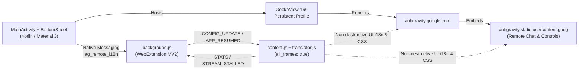

# Antigravity Remote Android

English | [简体中文](README.zh-CN.md)

[-3DDC84?logo=android&logoColor=white)](https://developer.android.com/)
[](https://mozilla.github.io/geckoview/)
[](#built-in-chinese-localization-plugin)
[](LICENSE)

An unofficial, open-source Android client for **Google Antigravity Remote Control**, built on **Mozilla GeckoView 160** and a bundled **WebExtension** (`ag-remote-zh@agremote.local`). It solves the everyday pain points of using the official mobile web dashboard—persistent sign-in, OAuth redirect handling, built-in Simplified Chinese UI localization, full-screen ergonomics, and background-resume stream recovery.

> All authentication, session traffic, and device connections go **directly** through the official [`https://antigravity.google.com/`](https://antigravity.google.com/) endpoints. This app does not proxy traffic, inspect credentials, or modify Antigravity's backend protocol.

---

## Why Use This Instead of a Mobile Browser?

| Pain Point in Mobile Browsers | How This App Solves It |
| :--- | :--- |
| Repeatedly re-opening tabs & re-authenticating | Persistent non-private **GeckoView** profile keeps Google cookies across restarts (`Android WebView` `403 disallowed_useragent` bypassed natively because GeckoView is standard Firefox). |
| Google verification jumping out to external browser | In-app `NavigationDelegate` & OAuth popup overlay keep `accounts.google.*` regional SSO flows (`accounts.google.com.hk`, `google.co.jp`, etc.) inside the app. |
| English-only interface & tiny mobile browser chrome | Built-in **WebExtension** translates 480+ Antigravity UI controls & dynamic badges into Simplified Chinese across both outer shell and inner iframe—with one-tap lossless toggle back to English. |
| Slow cold reloads & frozen streams after backgrounding | Pre-warms `GeckoSession` on startup, remembers your last machine (`/r/...`), keeps the session warm on Back (`moveTaskToBack`), and auto-recovers stalled streams on foreground resume while protecting unsent drafts. |

---

## Features

### 1. Persistent Google Login & Safe Navigation
- **Full OAuth Popup Overlay**: Handles `window.open` and multi-step Google SSO verification flows inside an in-app popup `GeckoView`.
- **Smart URL Policy**: Keeps Antigravity (`antigravity.google.com`, `antigravity.static.usercontent.goog`) and Google auth domains in-app; sends external third-party links tapped by the user to the system browser.

### 2. Built-in Chinese Localization Plugin
- **Cross-Frame Coverage (`all_frames: true`)**: Translates both the outer portal and the `antigravity.static.usercontent.goog` chat/workspace iframe.
- **Icon & Code Protection**:
  - Preserves Material Icons / Material Symbols ligatures (no broken icon glyphs) and skips `<code>`, `<pre>`, `<kbd>`, `<textarea>`, Monaco/CodeMirror editors, and `[data-no-translate]` blocks.
  - Protects AI/user conversation prose so only buttons, menus, approval actions, timestamps, and status indicators are localized.
- **Live Lossless Toggle & Custom JSON Dictionary**: Switch between **中文** and **English** instantly without reloading, or add custom JSON overrides in Settings for real-time hot updates via native messaging (`ag_remote_i18n`).

### 3. Immersive Mobile UI & Ergonomics
- **Adaptive Light & Dark System Bars**: Automatically matches your phone's light/dark theme with zero clashing top bars.
- **Draggable Right-Edge Floating Handle**: Tap to open a clean Material 3 bottom sheet with one-thumb access to **Devices List**, **Back**, **Sync/Reload**, **中文 / EN**, **Desktop / Mobile UA**, **Settings**, and **Clear Cache** (preserving login cookies). Drag vertically to dock anywhere along the right edge.
- **Native System Integration**: Supports Android file picker uploads (`PromptDelegate`), Web Notifications forwarding, keep-screen-on toggle, and `https://antigravity.google.com/*` deep links.

### 4. Speed & Background Stream Recovery
- **Cold-Start Pre-Warming & Direct Machine Launch**: Initializes and loads your last connected remote machine (`/r/...`) during `Application.onCreate()` so startup skips the device list.
- **Foreground Wake & Stall Detector**: Keeps the primary session at `PRIORITY_HIGH`, dispatches `online` / `focus` / `visibilitychange` on return from background, and watches for frozen running streams (`Working` / `执行中`). If stalled and no unsent draft exists in the input box, it reloads seamlessly; if a draft is present, it shows a non-destructive toast reminder instead.

---

## Architecture



---

## Quick Start

### Option A: Install Prebuilt APK (Recommended)
1. Download `antigravity-remote-android-v1.0.2-arm64-v8a-debug.apk` from [**GitHub Releases**](https://github.com/schau0826-crypto/antigravity-remote-android/releases) and install it on your Android phone (Android 8.0+, `arm64-v8a`).
2. On your computer, enable Antigravity Remote Control:
   - **Desktop App**: Open **Antigravity Desktop** → **Settings** → enable **Remote Control**, or
   - **CLI**: Run:
     ```bash
     agy remote-control start
     ```
3. Ensure your phone can reach `antigravity.google.com` and `accounts.google.com`, open **Antigravity 远程**, and sign in with your Google account once.

### Customizing Translations (No Rebuild Required)
Tap the **right-edge floating handle** → **更多设置 (Settings)** → **自定义汉化词典 (Custom Dictionary JSON)** and enter any key-value overrides:

```json
{
  "Remote Control": "远程控制",
  "Allow in sandbox": "允许在沙盒中运行"
}
```

Save to apply live across all open frames.

---

## Build & Test from Source

### Prerequisites
- **JDK 17 or 21** (e.g., Android Studio embedded JBR)
- **Android SDK** (`compileSdk 36`, `targetSdk 35`, `minSdk 26`)
- **Node.js 18+** (for WebExtension JS unit tests)

### 1. Configure Local SDK Path
Create `local.properties` in the project root (gitignored by default):

```properties
sdk.dir=/path/to/your/Android/sdk
```

### 2. Run Tests & Build APK

```bash
# Run WebExtension JS unit tests (18 tests)
node --test tests/i18n.test.mjs

# Run Android JVM unit tests & build arm64-v8a Debug APK
./gradlew testDebugUnitTest assembleDebug

# Build a universal multi-ABI APK (larger size)
./gradlew -Puniversal=true assembleDebug

# Install directly over ADB
adb install -r app/build/outputs/apk/debug/app-debug.apk
```

---

## Disclaimer & License

- **Unofficial Project**: This is an independent community wrapper and is not affiliated with, endorsed by, or maintained by Google or Mozilla. Please comply with applicable Terms of Service.
- **License**: Released under the [MIT License](LICENSE).
