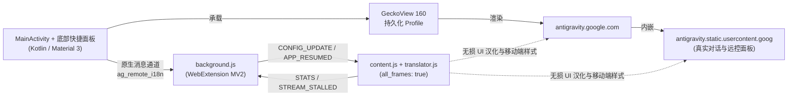

# Antigravity Remote Android

[English](README.md) | 简体中文

[-3DDC84?logo=android&logoColor=white)](https://developer.android.com/)
[](https://mozilla.github.io/geckoview/)
[](#2-%E5%86%85%E7%BD%AE%E4%B8%AD%E6%96%87%E6%B1%89%E5%8C%96%E6%8F%92%E4%BB%B6)
[](LICENSE)

基于 **Mozilla GeckoView 160 + 内置 WebExtension** 打造的 Google Antigravity Remote 非官方开源安卓客户端。专为解决手机浏览器使用官方 Remote Control 网页端时的痛点而设计：免重复登录、Google 地区验证不跳出浏览器、内置无损切换的中文界面、全屏沉浸交互，以及退后台切回后运行中会话自动续流。

> 本项目所有登录认证、会话通信与设备连接均**直连**官方 [`https://antigravity.google.com/`](https://antigravity.google.com/) 服务，不经过任何第三方中转，也不篡改或截留账号凭据。

---

## 为什么做这个客户端？（对比手机浏览器）

| 手机浏览器痛点 | 本客户端的解决方案 |
| :--- | :--- |
| 每次重开网页都要重新登录、普通 `WebView` 报错 | 使用标准 Firefox 内核 **GeckoView 160** 与持久化 Profile，原生支持 Google OAuth 而不触发 `403 disallowed_useragent`，登录态长期保留。 |
| Google 二次验证 / 地区 SSO 重定向会跳到系统浏览器 | 完整覆盖 `accounts.google.com.hk`、`google.co.jp` 等地区域名与 `SetSID` 跳转链，同时提供应用内弹窗叠加视图完成 OAuth 授权。 |
| 官方界面纯英文、移动端无定制快捷操作 | 内置 **WebExtension (`ag-remote-zh@agremote.local`)**，同时汉化外层外壳与内嵌对话 iframe，不破坏代码块与图标，支持一键无损切换回英文。 |
| 每次冷启动慢、退回后台切回来运行中的对话会断流卡死 | 启动预热 + 自动直达上次连接设备；主页返回采用后台保活（`moveTaskToBack`）；切回前台自动唤醒并检测断流，无未发送草稿时自动热同步最新进展。 |

---

## 核心功能

### 1. 持久登录与防误跳出导航策略
- **应用内 OAuth 弹窗**：通过 `NavigationDelegate.onNewSession` 在应用内叠加弹窗处理 Google 登录与安全验证弹窗，授权完毕自动关闭并回传结果。
- **精细化路由边界**：仅将 `antigravity.google.com`、`antigravity.static.usercontent.goog` 及 Google 认证域名留在应用内；用户在对话中主动点击的第三方外链则安全交由系统浏览器打开。

### 2. 内置中文汉化插件
- **全帧覆盖 (`all_frames: true`)**：同步注入外层页面与 `antigravity.static.usercontent.goog` 真实对话工作区 iframe，统一汇总翻译计数。
- **不破坏图标与正文**：
  - 自动识别 Material Icons / Material Symbols 等图标字体与连字元素，杜绝图标被误翻成汉字；
  - 严格跳过 `<code>`、`<pre>`、`<kbd>`、`<textarea>`、Monaco/CodeMirror 编辑器、`[data-no-translate]` 区域以及长段 AI/用户对话原文；
  - 支持 80ms / `requestAnimationFrame` 节流监听流式输出，不卡顿不闪屏。
- **实时无损切换与热更新词典**：在悬浮菜单即可无刷新切换 **中文 / 英文原版**；支持在设置中输入自定义 JSON 键值对，通过原生消息通道（`ag_remote_i18n`）实时热生效。

### 3. 沉浸式移动 UI、最近会话快切与实时上下文面板
- **状态栏与浅/深色主题自适应**：彻底去除顶部异色工具栏，页面与状态栏自动随系统浅色/深色模式切换，Web 界面占满全屏。
- **可拖拽右侧悬浮条（带四态圆点与上下文 % 角标）**：悬浮条左上角实时指示会话状态（蓝=运行中、琥珀=待确认、绿=静态就绪、红=异常），图标下方显示紧凑上下文占比百分比（达到 70%/85% 自动预警变色），支持沿右侧上下拖动并记住停靠位置。
- **Material 3 底部快捷面板**：轻点悬浮条即可单手访问：
  - **上下文与状态卡片**：实时展示当前模型名、四态状态徽标、上下文进度条（`已用 / 上限`、已压缩次数）及累计输入/缓存命中/输出/思考 Token 与步数明细（直读远程网页前端状态，无需改动服务端协议）；
  - **最近活跃会话（前 5 个）快切列表**：优先排序**运行中 / 待确认**会话，展示标题、工作区名称、相对活跃时间与实时状态徽标，点按即可通过 SPA 路由无刷新直切（若路由未挂载则自动保缓存 URL 跳转）；
  - **常用操作网格**：集成 **设备列表 / 返回上页 / 同步刷新 / 中文切换 / 桌面移动 UA 切换 / 更多设置 / 清除缓存（保留登录态）**。
- **完整系统能力接入**：支持文件上传选择器（SAF）、对话附件直存系统「下载」目录（`onExternalResponse`）、Web 通知转发、屏幕常亮开关及 `https://antigravity.google.com/*` 深链直达。
- **默认隐私与安全加固**：全量启用 HTTPS 网络安全策略（仅允许本机回环 `127.0.0.1`/`localhost`）、禁用系统备份（`allowBackup="false"` 保护 Google 登录 Cookie）、并对外部 `intent://` 跳转做组件与权限裁剪。

### 4. 加载提速、切网自愈与断流恢复
- **冷启动预热、防地址污染与网络精简**：在 `AntigravityApp.onCreate()` 预先加载上次连接的远程实例（`/r/...`，自动屏蔽 `?p=onboarding`/`login` 临时引导页以防污染），关闭 GeckoView 后台跟踪拦截/安全浏览同步与 DoH 探测以减少蜂窝网络 + VPN 下的连接争抢，并通过 `document_start` 提前 `preconnect` 静态 iframe 域名。
- **切网重连、超时提醒与崩溃熔断**：监听 Android `ConnectivityManager.NetworkCallback`，在 Wi-Fi/5G/VPN 切换后自动软唤醒或重载恢复；外层「正在连接到 instance...」超过 `18s` 自动弹出非阻塞重连条，断网/代理拒绝/证书异常提供中文引导兜底页（`onLoadError`），渲染进程连续崩溃（30 秒超过 3 次）自动熔断防死循环。
- **退后台保活与精准断流恢复**：
  - 保持主会话 `PRIORITY_HIGH` 优先级，主页按返回键调用 `moveTaskToBack(true)` 常驻后台，再次打开瞬时恢复；
  - 切回前台时向页面与 iframe 派发 `online` / `focus` / `visibilitychange` 软唤醒信号，仅在真实内层对话 iframe 且任务确实运行中（`Working` / `执行中`）时按网络状况自适应监控 `4.5s~6.5s`（交互或切路由立即取消），杜绝外层页面与空闲对话误触发整页刷新；
  - 确认运行中对话断流且无草稿时保留本地缓存重连；**若检测到输入框存在未发送文字，则只弹提示绝不覆盖草稿**。

---

## 架构概览



---

## 快速上手

### 方式一：直接下载 APK 安装（推荐）
1. 前往 [**GitHub Releases**](https://github.com/schau0826-crypto/antigravity-remote-android/releases) 下载 `antigravity-remote-android-v1.1.1-arm64-v8a-debug.apk` 并安装到 Android 手机（要求 Android 8.0+，`arm64-v8a` 架构）。
2. 在你的电脑端开启 Antigravity Remote Control（建议同时在设置里开启 **Keep computer awake** 防止休眠断隧道）：
   - **桌面端**：打开 **Antigravity Desktop** → 进入设置开启 **Remote Control**；
   - **命令行**：在终端执行：
     ```bash
     agy remote-control start
     ```
3. 确认手机当前网络可正常访问 `antigravity.google.com` 与 `accounts.google.com`，打开 **Antigravity 远程** 完成一次 Google 账号登录即可长期使用。若使用小米（MIUI / HyperOS）等系统，建议把 **Antigravity 远程** 与所用 VPN 应用的省电策略都设为 **「无限制」**，避免锁屏后系统强拆长连接。

### 自定义汉化词典（无需重新编译）
点击右侧边缘悬浮条 → **更多设置** → **自定义汉化词典 (JSON 对象)**，填入键值对即可热更新覆盖或扩充词条：

```json
{
  "Remote Control": "远程控制",
  "Allow in sandbox": "允许在沙盒中运行"
}
```

---

## 从源码构建与测试

### 环境要求
- **JDK 17 或 JDK 21**（如 Android Studio 内置 JBR）
- **Android SDK**（`compileSdk 36`、`targetSdk 35`、`minSdk 26`）
- **Node.js 18+**（运行 WebExtension JS 单元测试）

### 1. 配置本地 Android SDK 路径
在项目根目录创建 `local.properties`（默认已被 `.gitignore` 忽略，不会提交到 Git）：

```properties
sdk.dir=/path/to/your/Android/sdk
```

### 2. 运行单测与构建命令

```bash
# 运行内置 WebExtension JS 单元测试（30 项）
node --test tests/i18n.test.mjs

# 运行 Android JVM 单元测试并构建 arm64-v8a Debug APK
./gradlew testDebugUnitTest assembleDebug

# 构建开启 R8 压缩优化的 Release APK（配置本地 keystore.properties 或 AG_KEYSTORE_* 环境变量即可自动签名）
./gradlew assembleRelease

# 构建包含全部 ABI 的通用 APK（包体更大）
./gradlew -Puniversal=true assembleDebug

# 通过 ADB 安装到已连接的手机
adb install -r app/build/outputs/apk/debug/app-debug.apk
```

### 3. 可选固定 Release 签名（`keystore.properties`）
可在项目根目录创建 `keystore.properties`（默认已被 `.gitignore` 忽略，不会提交到 Git）或配置环境变量 `AG_KEYSTORE_PATH`、`AG_KEYSTORE_PASSWORD`、`AG_KEY_ALIAS`、`AG_KEY_PASSWORD`：

```properties
storeFile=/path/to/release.keystore
storePassword=your-store-password
keyAlias=your-alias
keyPassword=your-key-password
```

---

## 免责声明与开源协议

- **非官方说明**：本项目为个人社区开源封装工具，与 Google 或 Mozilla 没有任何官方关联；请在遵守相关服务条款及当地法律法规的前提下使用。
- **开源协议**：基于 [MIT License](LICENSE) 开源。
